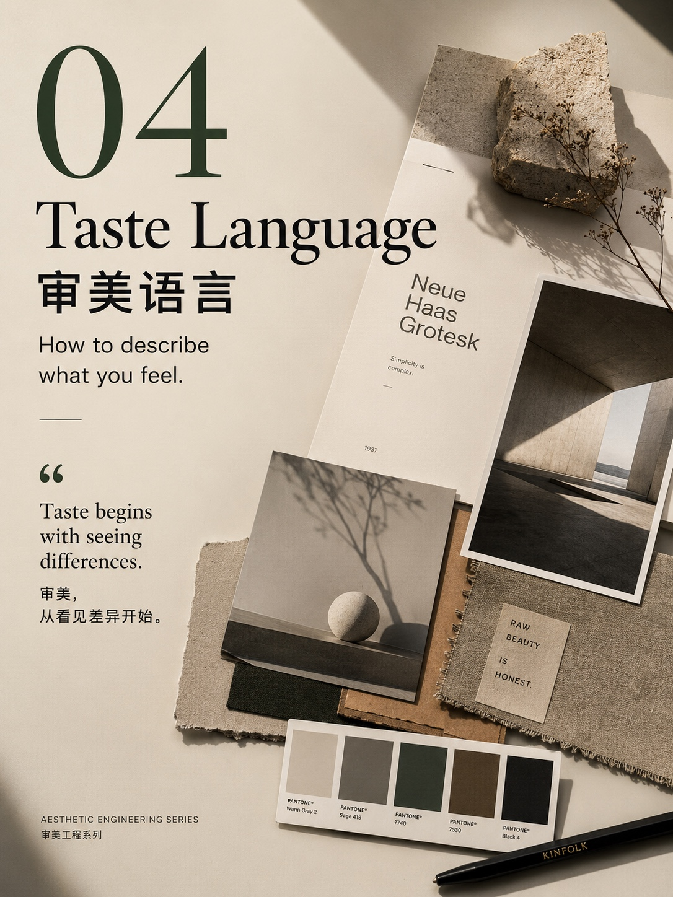
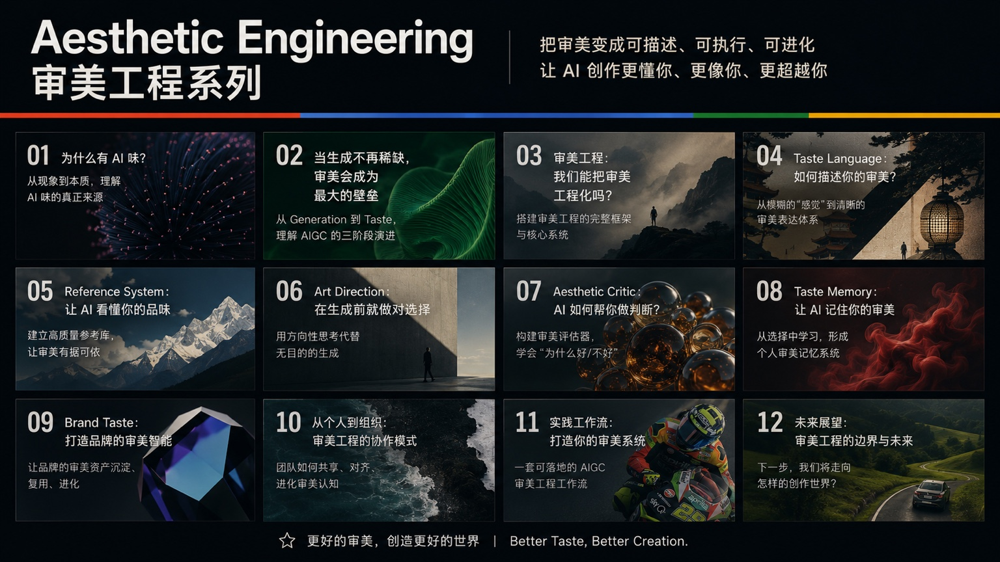

# 文章配图库

作者：**LeenMa**。这里保存作者在《AIGC美学选题》原对话中提供的两张配图，按原文件收录，供阅读、引用和传播本系列时使用。文章也可在 [作者的小红书](https://www.xiaohongshu.com/user/profile/5b4a2a3df7e8b94fcb3a2d6b) 阅读。

原创配图与说明采用 [CC BY 4.0](../../LICENSE-CONTENT)，使用时请署名 LeenMa、附上项目与许可链接，并注明修改。完整范围见 [NOTICE](../../NOTICE.md)。

## 第四篇 · 审美语言

[查看原图](04-taste-language-cover.jpg) · [阅读第四篇](../../content/04-审美语言.md)

封面标注的第 04 篇对应现行「审美语言」文章。它是系列创作时的封面版本，保留原有文字与画面。

## 早期系列总览

**这是历史宣传图，部分篇目及编号与现行十二篇目录不同。请以 [当前目录](../../README.md) 为准。**

[查看原图](series-overview-early.jpg)

图与现行目录的主要差异：

| 早期图中的内容 | 现行文章 |
| --- | --- |
| 01—06 | 主题对应当前 01—06，部分标题已修订 |
| 未单列「生成协议」 | 当前第 07 篇 |
| 07 · Aesthetic Critic | 当前第 08 篇「审美评审」 |
| 08 · Taste Memory | 当前第 09 篇「审美记忆」 |
| 09 · Brand Taste | 当前第 10 篇「品牌审美」 |
| 10 · 从个人到组织 | 当前第 11 篇「团队协作」 |
| 11 · 实践工作流 | 已从当前系列移除 |
| 12 · 未来展望 | 对应当前第 12 篇「边界与未来」 |

## 文件与来源

| 文件 | 来源与用途 |
| --- | --- |
| `04-taste-language-cover.jpg` | 原对话附件 `0ECF7581-FE58-4AF5-A44D-05C4B8ADA466.jpeg`；第四篇封面 |
| `series-overview-early.jpg` | 原对话附件 `0DBFE8EE-71DE-4A20-B06C-839E9DF62E75.jpeg`；早期系列总览 |

本目录当前收录这两张原图，未从总览中裁切出独立封面。新增配图时，请补充来源、对应篇目与版本说明，并检查图中文字是否与现行文章一致。
